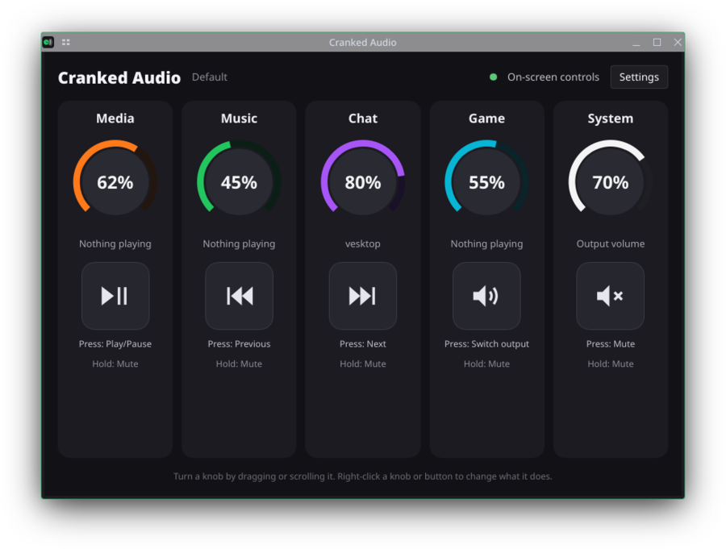

# Cranked Audio

Volume knobs for Linux: give each group of apps its own knob, on a USB mixer or right on screen.



## What it does

- **A knob per group of apps:** browsers and video on one knob, music on another, voice chat on a third, and
  "everything else" on a fourth. Apps are matched by name, so new windows and tabs follow their knob.
- **Works with or without hardware:** use a 5-knob USB serial mixer (CH343-based, with 15 RGB LEDs and 5 buttons),
  or drag and scroll the knobs in the window. Plug a mixer in later and it takes over.
- **Buttons:** press and hold actions: mute a knob, play/pause, next/previous track, switch audio output, next profile,
  or toggle anything in Home Assistant.
- **Auto-lower:** turns music and videos down while voice chat or another knob is playing, then brings them back.
- **Keeps apps in line:** apps that reset their own volume (Spotify does on every song) are put back at once.
  Only playback is touched; microphones and screen sharing never are.
- **Knob lights:** each knob fills with its own two colours, follows the level smoothly, dims when nothing is playing
  and goes dark when the screen locks. Built-in calibration keeps dimmed colours true on your LEDs.
- **Popups where you want them:** KDE's on-screen display, the Atoll dynamic island, or standard
  notifications (automatic picks the island when it's running).
- **Home Assistant:** a knob can dim a light, a button can toggle anything; changes made elsewhere show up live.
- **Profiles:** switch whole layouts (apps, colours, buttons, Auto-lower) from a button or the tray.
- **Light on the system:** a small background service (about 10 MB, near-zero CPU when idle) talks to PipeWire
  directly; the window only uses memory while it's open.

## Requirements

- Linux with PipeWire (with `pipewire-pulse`) or PulseAudio
- systemd user services (for starting at login)
- KDE Plasma is recommended (popups, tray); other desktops get standard notifications and a tray icon where supported
- Optional: the USB mixer; Home Assistant

## Install

Build and install for your user (needs [Rust](https://rustup.rs) and the PulseAudio development files, e.g.
`libpulse` on Arch or `libpulse-dev` on Debian/Ubuntu):

```bash
git clone https://github.com/Zach9113/cranked-audio.git
cd cranked-audio
./install.sh
```

Or install a prebuilt release (no compiler needed; the download is checked against its published checksum):

```bash
curl -sSL https://raw.githubusercontent.com/Zach9113/cranked-audio/main/install-release.sh | bash
```

Both install to `~/.local` (no root needed), add Cranked Audio to your app menu and start it at every login.

To remove it (your settings stay in `~/.config/cranked-audio`):

```bash
./install.sh --uninstall
```

(or, for a prebuilt install: `curl -sSL https://raw.githubusercontent.com/Zach9113/cranked-audio/main/install-release.sh | bash -s -- --uninstall`)

Experimental: each release also has `CrankedAudio-x86_64.AppImage` to try it without installing (no automatic start
at login).

## Using it

Open **Cranked Audio** from the app menu or click the tray icon. Drag or scroll a knob to turn it; right-click a knob
to choose its apps, colours and range, and right-click a button to choose what a press and a hold do.
**Settings** covers profiles, Auto-lower, LED brightness and calibration, popups and Home Assistant.

Everything is saved in `~/.config/cranked-audio/config.toml` (editing it by hand works too; changes apply at once).
The Home Assistant token is kept in its own file, readable only by you.

## Development

```bash
cargo build --release
target/release/cranked-audiod --dry-run -v     # show which app goes on which knob, change nothing
cargo test && tests/live.sh && tests/live_ha.sh && tests/live_duck.sh
```

`SPEC.md` describes how everything behaves; `PLAN.md` is the roadmap.

## Made with AI

Cranked Audio was built with heavy use of AI coding assistants: most of the code, tests and documentation were
written by Claude (Anthropic, through Claude Code), with some work by Gemini (Google), under the direction of
Zach9113, who designed the features, made the decisions, and tested everything on real hardware. Commits that AI
helped write carry a `Co-Authored-By` line. Bug reports and reviews from humans are very welcome.

## License

Copyright (C) 2026 Zach9113. Free software under the GNU General Public License, version 3 or later; see `LICENSE`.
